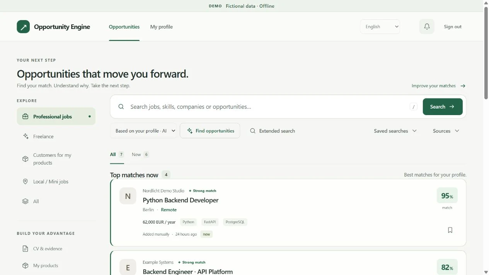
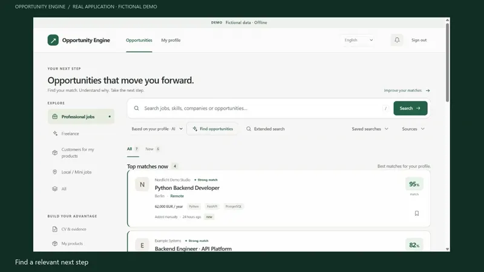
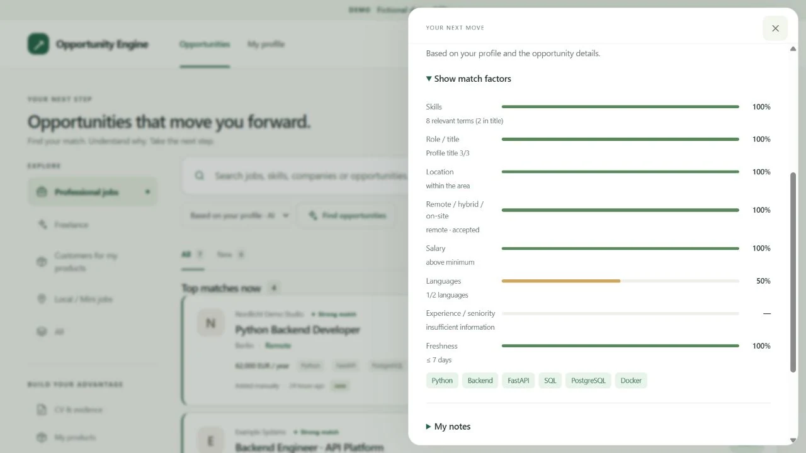
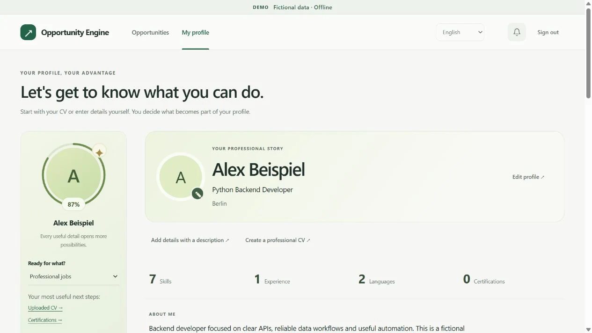
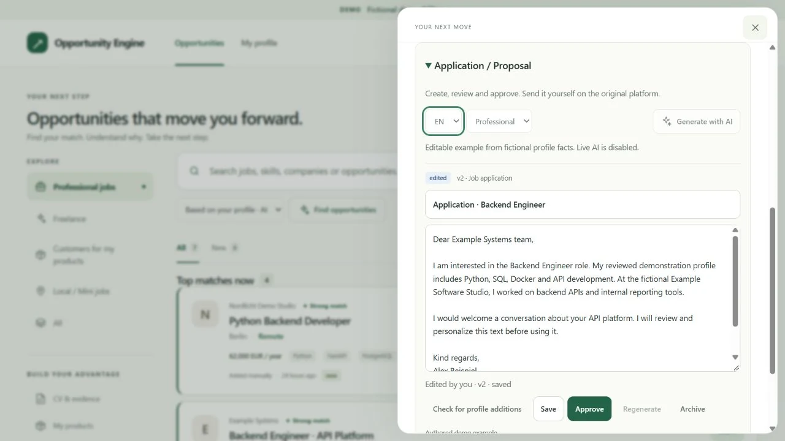
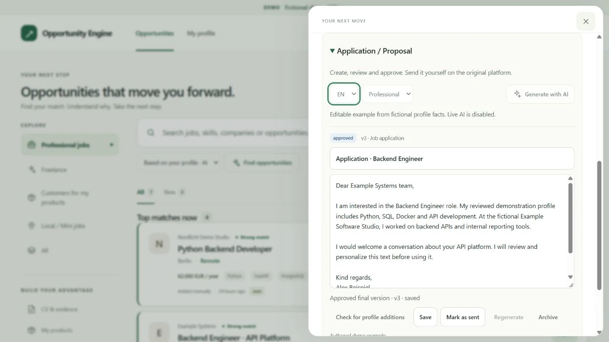
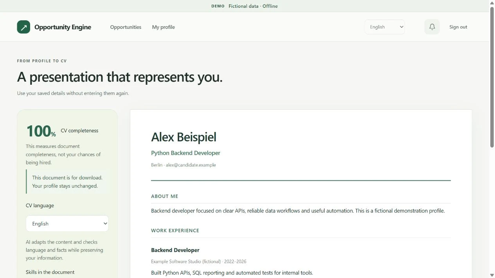
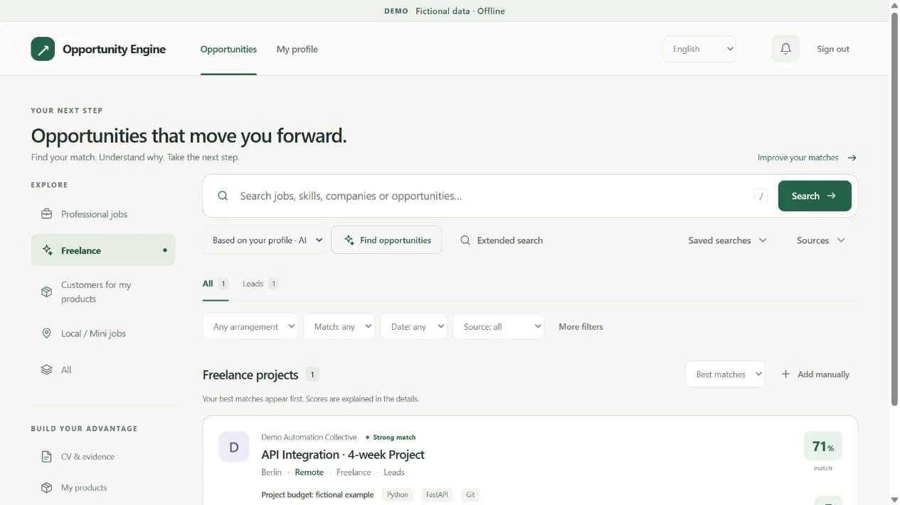

# Opportunity Engine

**Passende Möglichkeiten finden. Verstehen, warum sie passen. Den nächsten Schritt selbst entscheiden.**

Eine persönliche Arbeitsfläche für Jobs und Freelance: aus überprüften Profilangaben werden nachvollziehbare Matches und bearbeitbare Bewerbungsentwürfe. Nichts wird automatisch an Arbeitgeber gesendet.

[](https://github.com/IamRedi/opportunity-engine-showcase/actions/workflows/ci.yml)

**Python 3.14 · FastAPI · SQLite / optional libSQL · SQ / EN / DE**



**[English](README.en.md)** · **[Lokal ausprobieren](#lokal-ausprobieren)** · **[Prüfprotokoll](EVIDENCE.md)** · **[Architektur](docs/ARCHITECTURE.md)**

> **Nachweisstand und Grenzen:** Entwickelter Prototyp mit ausschließlich fiktiver, offline ausführbarer Demonstration. Öffentliche Registrierung, produktive Vermittlung und automatischer Bewerbungsversand sind nicht Bestandteil dieser Freigabe; die dokumentierten Tests verwenden keine realen Bewerberdaten. [Prüfprotokoll (EN)](EVIDENCE.md).

## Was das Produkt löst

Stellenangebote, ein CV und Notizen allein beantworten noch nicht die Frage: *Welche Möglichkeit passt zu mir, welche Information fehlt und was mache ich als Nächstes?*

- **Ein überprüfbares Profil:** CV-Import, manuelle Angaben und strukturierte Fähigkeiten, Erfahrung und Projekte. Vorschläge sind keine automatisch bestätigten Qualifikationen.
- **Erklärbare Relevanz:** Faktoren für Fähigkeiten, Rolle, Ort, Arbeitsform, Gehalt, Sprache und Aktualität. Unbekannte Angaben bleiben unbekannt. Ein Match-Wert ist keine Einstellungswahrscheinlichkeit.
- **Eine kontrollierte Bewerbung:** speichern, einen Entwurf bearbeiten, Versionen vergleichen und freigeben. Das tatsächliche Versenden bleibt beim Menschen.
- **Unterschiedliche Wege:** Jobs und Freelance haben eigene Ansichten und Statusfolgen; weitere Bereiche für Produkt-Leads und lokale Arbeit sind im Code enthalten.

## Ein kurzer Rundgang

Profil → Möglichkeiten → Match-Faktoren → Entwurf → persönliche Freigabe → CV-Vorschau.

[](docs/assets/video/walkthrough-de.mp4)

**[Video DE · MP4](docs/assets/video/walkthrough-de.mp4)** · **[Video EN · MP4](docs/assets/video/walkthrough-en.mp4)** · **[Transkript](docs/assets/video/transcript.md)**

Der stumme, beschriftete Rundgang ist aus echten Screenshots der lokalen Anwendung montiert. Alle Personen und Angebote sind fiktiv; es gibt keine Live-KI, keine echte Stellensuche und keinen Bewerbungsversand. [Herkunft der Medien](docs/MEDIA.md).

## Einblick in die Anwendung

### Warum passt diese Stelle?



### Vom Profil zum überprüften Entwurf

| Überprüfbare Profilangaben | Bearbeitbarer Entwurf |
|---|---|
|  |  |

<details>
<summary>Freigabe, CV-Vorschau und Freelance ansehen</summary>



| CV aus Profilangaben | Freelance-Projekt |
|---|---|
|  |  |

</details>

## Lokal ausprobieren

**Voraussetzung: Python 3.14. Kein API-Schlüssel erforderlich.** Die Installation lädt Python-Pakete; die laufende Demo blockiert externe Verbindungen.

Linux / macOS:

```bash
python3.14 -m venv .venv
source .venv/bin/activate
python -m pip install -r requirements.txt -c constraints/python314-linux.txt
python scripts/serve_demo.py
```

<details>
<summary>Windows / PowerShell</summary>

```powershell
py -3.14 -m venv .venv
.\.venv\Scripts\python.exe -m pip install -r requirements.txt -c constraints/python314-linux.txt
.\.venv\Scripts\python.exe scripts/serve_demo.py
```

</details>

Öffnen: **http://127.0.0.1:8765/?lang=de** oder **http://127.0.0.1:8765/?lang=en**.

Die Demo legt eine neue `.demo/`-Datenbank mit Alex Beispiel und acht fiktiven Angeboten an. Sie liest keine bestehende Datenbank und keine persönlichen `.env`-Dateien. Änderungen an der Demo bleiben bei einem Neustart erhalten. Zum Zurücksetzen nach dem Stoppen ausschließlich die generierte `.demo/`-Mappe entfernen.

Alternativ mit Docker:

```bash
docker compose up --build
```

Der Container läuft ohne root; nur der Loopback-Port wird veröffentlicht. Diese lokale Auswertungsumgebung ist kein öffentliches Hosting-Angebot.

## Technik und Qualität

- **FastAPI + Jinja + JavaScript:** serverseitig gerenderte Ansichten, progressive UI und ein Detail-Panel ohne Seitenwechsel.
- **SQLite:** versionierte Migrationen, normalisierte Angebote und Deduplizierung. Ein optionaler libSQL-Adapter ist separat testbar.
- **Explizite Grenzen:** Profilfakten, Suchsignale, Matching und Bewerbungsentwürfe bleiben unterscheidbar. Cloud-Module enthalten Actor-/Tenant-Kontext, Usage-Ledger und durable Background-Jobs.
- **CI:** vollständige Python-Regressionssuite einschließlich lokaler libSQL-Tests, Offline-Demo-Smoke, Scan der Veröffentlichungsdateien, Gitleaks und Container-Smoke. Ergebnisse und Grenzen stehen im [Prüfprotokoll](EVIDENCE.md).

Die vollständigen Tests benötigen zusätzlich **Node.js 22** für die Frontend-Vertragsprüfungen.

```bash
python -m pip install -r requirements-ci.txt -c constraints/python314-linux.txt
python -m pytest -q
python scripts/serve_demo.py --check
python scripts/check_public_snapshot.py
```

Die vollständige Cloud-Adapter-Suite wird unter Linux geprüft. Die normale SQLite-Demo braucht weder libSQL noch die Vercel-SDKs. Tests und Demo verwenden keine echten Providerkonten.

## Ehrlicher Produktstand

Diese Fassung zeigt einen entwickelten Prototyp mit nachvollziehbaren Kernabläufen, kein fertiges Recruiting-SaaS. Such- und AI-Adapter sind im Code vorhanden, aber im Showcase deaktiviert. Öffentliche Registrierung, Abrechnung, automatischer Bewerbungsversand und ein frei zugänglicher Live-Pilot sind nicht Teil dieser Präsentation. Sprachqualität bei AI-Ausgaben und zusätzliche Betriebsfreigaben bleiben separate Aufgaben. [Umfang und bekannte Grenzen](docs/PUBLIC_SCOPE.md) · [Sicherheit](SECURITY.md).

## Autor und Nutzung

Entwickelt von **Redion Cekrezi / RediON**. Der Mensch bestimmt Produkt und Grenzen; KI-Werkzeuge unterstützen Entwicklung und Prüfung.

Der Code darf zur Bewertung gelesen, geklont und lokal ausgeführt werden. Produktion, kommerzielle Nutzung und Weiterverteilung benötigen eine schriftliche Erlaubnis. Dies ist **source-available**, nicht Open Source. [Lizenz](LICENSE) · [Kontakt](https://github.com/IamRedi).
