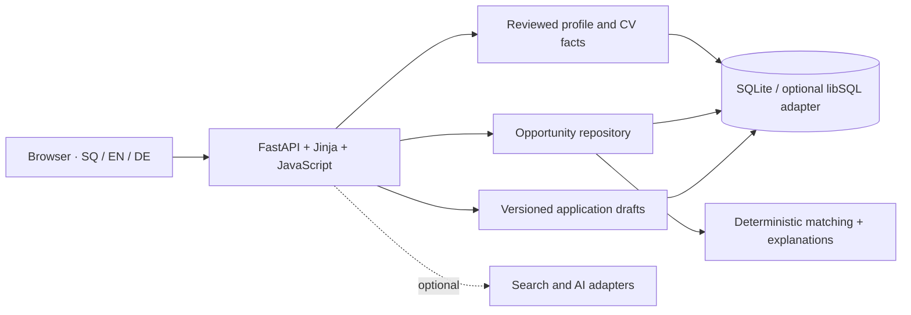

# Architecture

`app.py` handles HTTP routes. `repository.py` owns SQLite schema and persistence.
`matching.py` scores relevance and retains unknown information as unknown.
`profile_context.py`, `cv_parser.py`, `cv_merge.py` and profile modules manage
reviewed facts. `applications.py` and `generator.py` manage application drafts.
`context.py`, `tenancy.py` and auth modules enforce actor-derived cloud scoping.
Usage accounting and durable work live in the `usage_*` and `background_*` modules.

The showcase adds a small launcher, synthetic fixture and network boundary.
It does not replace the matching algorithm with scripted scores. All displayed
scores are calculated by the application. They are relevance indicators,
not probabilities of receiving an offer.

The code remains a modular Python application. The large route/repository
modules are an acknowledged maintenance tradeoff, not a claim of microservices.
